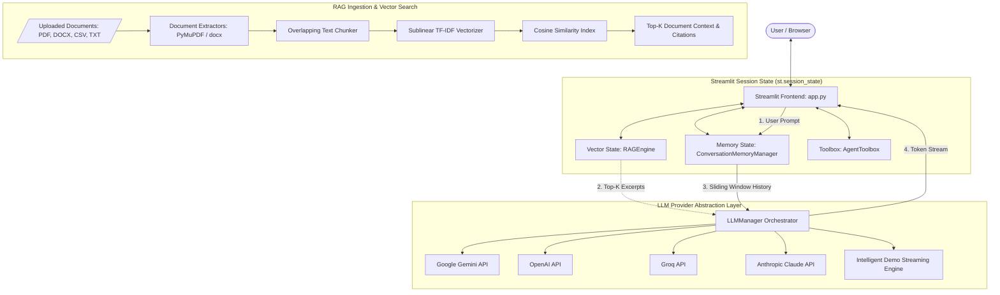

# ⚡ Interactive Full-Stack AI Chatbot with Streamlit & LangChain

[](https://streamlit.io)
[](https://www.python.org/)
[](https://python.langchain.com/)
[](https://opensource.org/licenses/MIT)
[](https://github.com/psf/black)

> **Enterprise-grade, full-stack conversational AI web application featuring real-time token streaming, sliding-window conversation memory, multi-format document RAG, dynamic multi-provider routing (Gemini, OpenAI, Groq, Claude), and telemetry analytics.**

---

## 📑 Table of Contents
- [Overview](#-overview)
- [Key Features](#-key-features)
- [System Architecture](#-system-architecture)
- [Project Structure](#-project-structure)
- [Prerequisites & Requirements](#-prerequisites--requirements)
- [Quickstart Guide](#-quickstart-guide)
- [Configuration & Environment](#-configuration--environment)
- [Modes of Operation](#-modes-of-operation)
  - [1. Standard Conversational AI](#1-standard-conversational-ai)
  - [2. RAG (Document Knowledge Base)](#2-rag-document-knowledge-base)
  - [3. Agent Tools & Actions](#3-agent-tools--actions)
- [Session State & Memory Architecture](#-session-state--memory-architecture)
- [Testing & Quality Assurance](#-testing--quality-assurance)
- [Deployment Guide](#-deployment-guide)
- [Contributing](#-contributing)
- [License](#-license)

---

## 🌟 Overview

The **Interactive Full-Stack AI Chatbot** is a production-ready conversational web application built from the ground up using **Streamlit** and **LangChain**. It bridges state-of-the-art Large Language Models with local organizational knowledge, featuring responsive token streaming, robust multi-turn memory buffers, and an embedded retrieval-augmented generation (RAG) vector engine.

The platform provides a **zero-key Demo Mode** out-of-the-box, allowing users and evaluators to test all conversational flows, document indexing, and source citation features without requiring an external paid API key.

---

## ✨ Key Features

- **⚡ Real-Time Streaming Token Output:** High-responsiveness token generator rendering words as they are synthesized using Streamlit's native `st.write_stream` and LangChain streaming callbacks.
- **🧠 Sliding-Window Conversation Memory:** Multi-turn dialogue retention using `st.session_state` and windowed context management (`ConversationMemoryManager`), preventing token overflows while maintaining conversation flow.
- **📚 Multi-Format Document RAG Engine:** Ingests **PDF**, **DOCX**, **CSV**, **Markdown**, and **TXT** files. Performs text chunking, builds an in-memory sublinear TF-IDF vector index with cosine similarity search, and provides inline source attributions.
- **🔀 Multi-Provider & Model Orchestrator:**
  - **Google Gemini:** `gemini-2.5-flash`, `gemini-2.5-pro`, `gemini-1.5-flash`
  - **OpenAI:** `gpt-4o`, `gpt-4o-mini`, `o3-mini`
  - **Groq:** `llama-3.3-70b-versatile`, `mixtral-8x7b-32768`
  - **Anthropic:** `claude-3-5-sonnet`, `claude-3-5-haiku`
  - **Demo Mode:** Local zero-dependency intelligent streaming simulation with RAG support.
- **🛠️ Agent Tool Pipeline:** Integrated sandboxed math evaluator, system clock, and web search tooling.
- **🎨 Modern Dark UI Theme:** Custom CSS styling with gradient headers, status badges, expandable source citation cards, and quick-prompt starters.
- **📊 Real-Time Session Telemetry:** Live counters for message turns, word counts, token estimations, and generation latency.
- **💾 Transcript Exporter:** One-click export of complete conversations into structured **JSON** or clean **Markdown**.

---

## 📐 System Architecture



---

## 📂 Project Structure

```
Interactive-Full-Stack-AI-Chatbot/
├── app.py                      # Streamlit application entry point & reactive loops
├── requirements.txt            # Production dependencies
├── .env.example                # Template for environment variables and API keys
├── .gitignore                  # Git exclusions for Python caches and secrets
├── README.md                   # Enterprise-grade documentation
├── sample_data/
│   └── sample_knowledge.txt    # Ready-to-use sample document for RAG testing
├── core/
│   ├── __init__.py             # Core package initialization
│   ├── config.py               # Model catalog, system personas, and defaults
│   ├── memory_manager.py       # Sliding-window conversation buffer & serializer
│   ├── rag_engine.py           # Document parser, chunker, and in-memory vector index
│   ├── llm_manager.py          # Unified streaming provider (Gemini, OpenAI, Groq, Demo)
│   └── agent_tools.py          # Sandboxed math evaluator and agent utilities
├── ui/
│   ├── __init__.py             # UI package initialization
│   ├── components.py           # Modular Streamlit components (sidebar, header, metrics)
│   └── styles.css              # Custom CSS stylesheet
└── tests/
    ├── __init__.py             # Test suite package
    ├── test_memory.py          # Memory pruning and export unit tests
    ├── test_rag.py             # Document parsing and cosine search unit tests
    └── test_llm.py             # Streaming generator and toolbox unit tests
```

---
## UI/UX Screenshot


---
---

## 💻 Prerequisites & Requirements

- **Operating System:** Windows, macOS, or Linux
- **Python Version:** Python 3.10, 3.11, 3.12, or 3.14
- **Browser:** Chrome, Firefox, Safari, or Edge

---

## 🚀 Quickstart Guide

### 1. Clone the Repository
```bash
git clone https://github.com/your-username/interactive-fullstack-ai-chatbot.git
cd interactive-fullstack-ai-chatbot
```

### 2. Set Up a Virtual Environment
```bash
# On macOS/Linux:
python3 -m venv venv
source venv/bin/activate

# On Windows:
python -m venv venv
venv\Scripts\activate
```

### 3. Install Dependencies
```bash
pip install -r requirements.txt
```

### 4. (Optional) Configure API Keys
Copy `.env.example` to `.env` and enter your preferred provider API keys:
```bash
cp .env.example .env
```
*(If you do not configure an API key, the chatbot automatically operates in **Demo Mode**, providing full streaming and RAG capabilities without cost).*

### 5. Launch the Streamlit Application
```bash
streamlit run app.py
```
Open your browser and navigate to **`http://localhost:8501`**.

---

## ⚙️ Configuration & Environment

The application dynamically reads configuration from `.env` or from the interactive sidebar:

| Environment Variable | Description | Default |
|---|---|---|
| `GEMINI_API_KEY` | Google AI Studio Gemini API Key | *None* |
| `OPENAI_API_KEY` | OpenAI Platform API Key | *None* |
| `GROQ_API_KEY` | Groq Developer Cloud API Key | *None* |
| `ANTHROPIC_API_KEY` | Anthropic Claude API Key | *None* |
| `STREAMLIT_SERVER_PORT` | Local web server port | `8501` |
| `STREAMLIT_SERVER_HEADLESS` | Run in headless server mode | `true` |

---

## 🕹️ Modes of Operation

### 1. Standard Conversational AI
- Engage in fluid, multi-turn dialogues with conversational memory.
- Select from predefined personas (e.g., *Senior Software Architect*, *Data Analyst*, *Creative Writer*) or define your own system instructions in the sidebar.
- Adjust hyperparameters: **Temperature** (randomness), **Max Output Tokens**, and **Memory Window Size**.

### 2. RAG (Document Knowledge Base)
1. Select **RAG (Document Knowledge Base)** in the sidebar.
2. Upload one or multiple files (**PDF**, **DOCX**, **CSV**, **TXT**, **MD**). You can use the provided sample in `sample_data/sample_knowledge.txt`.
3. Click **"Process & Index Documents"**.
4. Ask questions regarding your private documentation.
5. The assistant streams answers grounded in your documents and surfaces an expandable **Retrieved Knowledge Sources** card with document names, page numbers, match percentages, and excerpt snippets.

### 3. Agent Tools & Actions
- Select **Agent Tools & Actions** in the sidebar.
- Query mathematical expressions (e.g., `what is 144 * 25 + sqrt(16)`).
- Ask for real-time temporal grounding (e.g., `what is the current time and date?`).
- The agent executes the sandboxed tool and outputs structured reasoning before answering.

---

## 🧠 Session State & Memory Architecture

Streamlit re-executes the script from top-to-bottom on each user interaction. To prevent memory loss and duplicate computation, the application leverages `st.session_state`:

1. **`st.session_state["memory"]` (`ConversationMemoryManager`):**
   - Retains conversation turns across re-runs.
   - Implements sliding-window pruning to keep context within model limits.
   - Provides conversion to LangChain `BaseMessage` format (`HumanMessage`, `AIMessage`, `SystemMessage`).
2. **`st.session_state["rag_engine"]` (`RAGEngine`):**
   - Keeps vector embeddings and index matrices in-memory across interactions.
   - Avoids re-vectorizing documents on every message submission.
3. **`st.session_state["toolbox"]` (`AgentToolbox`):**
   - Houses isolated, sandboxed execution tools.

---

## 🧪 Testing & Quality Assurance

The codebase includes comprehensive unit tests covering all core modules. Run the test suite using Python's native `unittest`:

```bash
python -m unittest discover tests
```

### Test Suite Summary:
- **`tests/test_memory.py`:** Tests message tracking, sliding window pruning, token estimation, JSON and Markdown serialization.
- **`tests/test_rag.py`:** Tests document parsing, chunking with boundary snapping, TF-IDF cosine vector retrieval, and context formatting.
- **`tests/test_llm.py`:** Tests streaming generators, fallback mechanisms, and tool sandboxing.

---

## 🐳 Deployment Guide

### Deploying via Docker

1. Create a `Dockerfile`:
```dockerfile
FROM python:3.11-slim

WORKDIR /app
COPY requirements.txt .
RUN pip install --no-cache-dir -r requirements.txt

COPY . .
EXPOSE 8501

CMD ["streamlit", "run", "app.py", "--server.port=8501", "--server.address=0.0.0.0"]
```

2. Build and run:
```bash
docker build -t fullstack-ai-chatbot .
docker run -p 8501:8501 --env-file .env fullstack-ai-chatbot
```

### Deploying to Streamlit Community Cloud
1. Push this repository to GitHub.
2. Visit [share.streamlit.io](https://share.streamlit.io) and link your GitHub account.
3. Select your repository and specify `app.py` as the entrypoint.
4. Add your API keys under **Advanced Settings > Secrets**:
   ```toml
   GEMINI_API_KEY = "your-key"
   OPENAI_API_KEY = "your-key"
   ```
5. Click **Deploy**!

---

## 🤝 Contributing

Contributions, bug reports, and feature requests are welcome!
1. Fork the Project
2. Create your Feature Branch (`git checkout -b feature/AmazingFeature`)
3. Commit your Changes (`git commit -m 'Add some AmazingFeature'`)
4. Push to the Branch (`git push origin feature/AmazingFeature`)
5. Open a Pull Request

---

## 📄 License

Distributed under the **MIT License**. See `LICENSE` for details.

