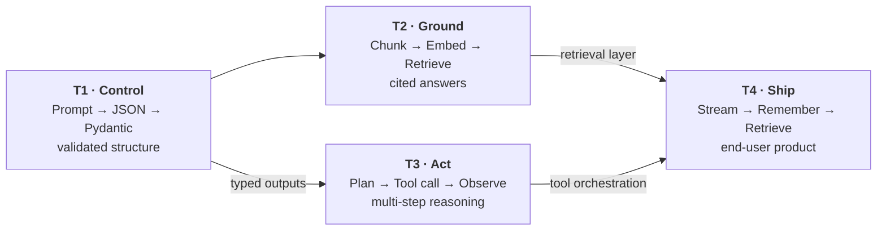
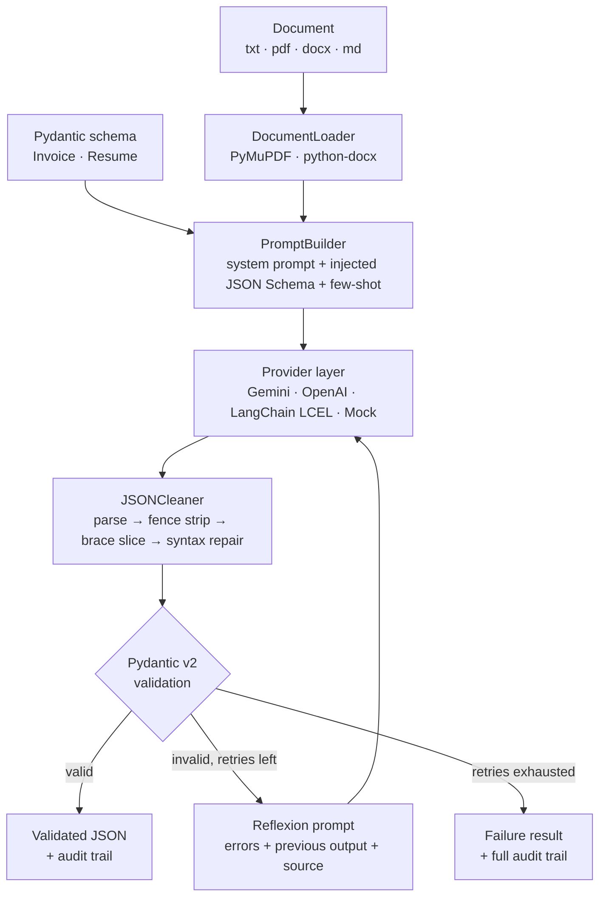
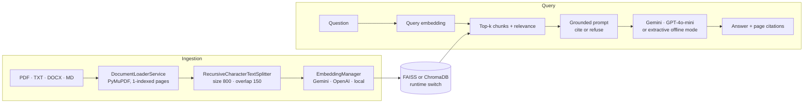
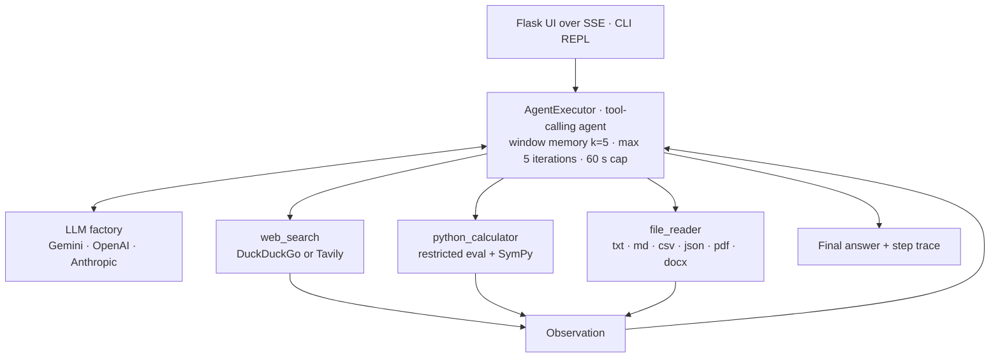
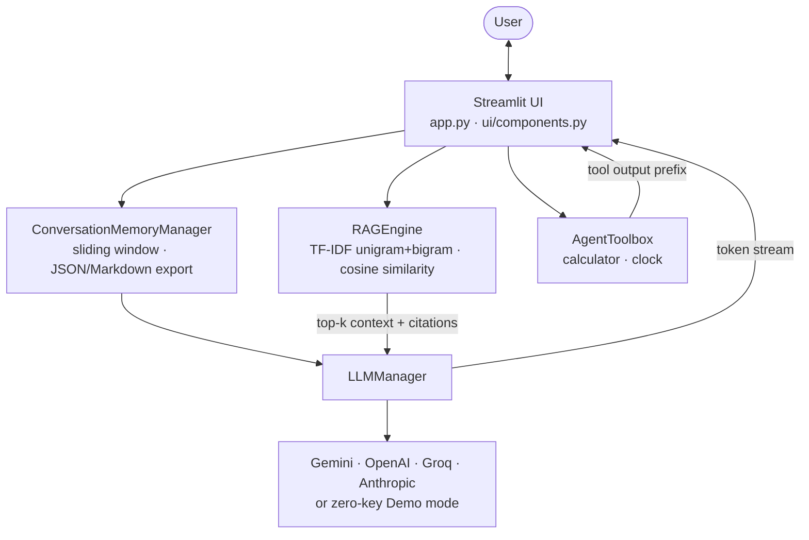

<div align="center">

# Python + Generative AI & LangChain Internship Portfolio

**Four production-style GenAI systems, one engineering thread: making LLM behaviour structured, grounded, autonomous and shippable.**

*Datheon Python + Generative AI & LangChain Internship · 4-Week Program Tasks & Milestones*

[](https://www.python.org/)
[](https://www.langchain.com/)
[](https://docs.pydantic.dev/)
[](https://flask.palletsprojects.com/)
[](https://streamlit.io/)
[](https://github.com/facebookresearch/faiss)
[](https://www.trychroma.com/)
[](LICENSE)

[Overview](#overview) •
[Projects](#portfolio-at-a-glance) •
[Architecture](#how-the-projects-fit-together) •
[Getting Started](#getting-started) •
[Verification](#verification-and-quality) •
[Roadmap](#known-limitations-and-hardening-roadmap)

</div>

---

## Table of Contents

- [Overview](#overview)
- [Portfolio at a Glance](#portfolio-at-a-glance)
- [How the Projects Fit Together](#how-the-projects-fit-together)
- [Cross-Cutting Engineering Principles](#cross-cutting-engineering-principles)
- [Task 1: Structured LLM Prompt Pipeline & JSON Extractor](#task-1-structured-llm-prompt-pipeline--json-extractor)
- [Task 2: Document Q&A Assistant with RAG & Vector Embeddings](#task-2-document-qa-assistant-with-rag--vector-embeddings)
- [Task 3: Multi-Tool Autonomous AI Agent](#task-3-multi-tool-autonomous-ai-agent)
- [Task 4: Interactive Full-Stack AI Chatbot with Streamlit](#task-4-interactive-full-stack-ai-chatbot-with-streamlit)
- [Technology Matrix](#technology-matrix)
- [Repository Layout](#repository-layout)
- [Getting Started](#getting-started)
- [Verification and Quality](#verification-and-quality)
- [Known Limitations and Hardening Roadmap](#known-limitations-and-hardening-roadmap)
- [Competencies Demonstrated](#competencies-demonstrated)
- [Author and License](#author-and-license)

---

## Overview

This repository contains the deliverables for the four tasks of the **Datheon Python + Generative AI & LangChain Internship** (a 4-week program), presented in program order. Each task is an independently runnable application with its own dependencies, tests and documentation. Together they trace the full arc of applied LLM engineering:

| Task | Stage | Question the task answers |
| :-: | :--- | :--- |
| **1** | **Control** | How do I make a probabilistic model return *typed, validated, machine-readable* output? → [Structured LLM Prompt Pipeline & JSON Extractor](#task-1-structured-llm-prompt-pipeline--json-extractor) |
| **2** | **Ground** | How do I make a model answer from *my* documents and prove where each answer came from? → [Document Q&A Assistant with RAG & Vector Embeddings](#task-2-document-qa-assistant-with-rag--vector-embeddings) |
| **3** | **Act** | How do I let a model *choose and call tools* to complete multi-step problems? → [Multi-Tool Autonomous AI Agent](#task-3-multi-tool-autonomous-ai-agent) |
| **4** | **Ship** | How do I wrap streaming, memory, retrieval and provider choice into *one usable product*? → [Interactive Full-Stack AI Chatbot with Streamlit](#task-4-interactive-full-stack-ai-chatbot-with-streamlit) |

A deliberate design choice runs through the portfolio: **three of the four systems run end-to-end with no API key** (offline mock, local embeddings, demo simulator), so every reviewer can execute them immediately and the test suites stay deterministic.

> **A note on rigor.** Every figure and capability claim in this document was reconciled against the source code and a fresh test run (see [Verification and Quality](#verification-and-quality)). Where an earlier per-project README made a claim the code does not support, it has been corrected or omitted here rather than carried forward.

---

## Portfolio at a Glance

| Task | Deliverable | Core problem | Key techniques | Interface | Runs without API key | Tests (verified) |
| :-: | :--- | :--- | :--- | :--- | :-: | :-: |
| 1 | [**Structured LLM Prompt Pipeline & JSON Extractor**](structured_LLM_prompt_pipeline/) | Reliable JSON extraction from messy invoices and resumes | Parameterised prompts, few-shot exemplars, Pydantic v2 cross-validation, multi-stage JSON repair, reflexion retry loop | Rich CLI + Flask dashboard | Yes (mock provider) | 22 / 22 |
| 2 | [**Document Q&A Assistant with RAG & Vector Embeddings**](documents%20Q%26A%20assistant%20with%20RAG%20embeddings/) | Answers grounded in uploaded PDFs with page citations | Recursive chunking, dual FAISS/ChromaDB stores, multi-provider embeddings, strict grounding prompt | Flask REST API + web UI | Yes (local embeddings + extractive answers) | 5 / 6 on Linux (see notes) |
| 3 | [**Multi-Tool Autonomous AI Agent**](multi-tool%20autonomous%20AI%20agent/) | Multi-step tasks needing search, math and file access | Native tool-calling agent, window memory, restricted-eval calculator with SymPy, bounded file reader, SSE trace streaming | Flask + SSE UI and CLI REPL | No (needs an LLM key) | 42 / 42 (tool layer) |
| 4 | [**Interactive Full-Stack AI Chatbot with Streamlit**](Interactive%20full%20stack%20AI%20chatbot%20with%20streamlit/) | A complete chat product with streaming, memory and retrieval | Token streaming, sliding-window memory, in-memory TF-IDF RAG, 4-provider routing, transcript export | Streamlit | Yes (demo simulator) | 14 / 14 |

---

## How the Projects Fit Together



The projects are independent codebases, but the later ones reuse ideas established earlier: structured validation (T1) is what makes tool inputs and outputs trustworthy in T3; the retrieval concepts from T2 reappear, in a lighter lexical form, inside the T4 chatbot.

---

## Cross-Cutting Engineering Principles

| Principle | How it is applied | Where |
| :--- | :--- | :--- |
| **Provider abstraction** | A thin interface or factory isolates vendor SDKs so providers can be swapped by configuration. | T1 `BaseLLMProvider`; T3 `create_llm()`; T4 `LLMManager` |
| **Graceful degradation** | Missing keys or provider failures route to an offline path instead of crashing. | T1 mock provider; T2 local embeddings + extractive synthesiser; T4 demo simulator and error fallback |
| **Validate at the boundary** | LLM output is treated as untrusted input and parsed, typed and cross-checked before use. | T1 `JSONCleaner` → Pydantic; T2 upload allow-list and `secure_filename` |
| **Bounded autonomy** | Agent loops are capped by iteration count and wall-clock time; file and output sizes are limited. | T3 `max_iterations=5`, `max_execution_time=60`, 5 MB file cap |
| **Explainability** | Outputs carry their provenance: audit trails, citations, retrieval scores, tool traces. | T1 audit trail; T2 page citations; T3 step trace; T4 source cards |
| **Separation of concerns** | Ingestion, retrieval, generation, state and UI live in separate modules. | All four (`core/`, `providers/`, `schemas/`, `ui/`, `tools/`) |
| **Deterministic testing** | Offline components allow reproducible tests without network or cost. | T1 mock provider; T2 local embeddings; T4 demo mode |

---

## Task 1: Structured LLM Prompt Pipeline & JSON Extractor

> **Program brief:** Extract structured data from unstructured text using LLM APIs with Python.  
> **Folder:** [`structured_LLM_prompt_pipeline/`](structured_LLM_prompt_pipeline/) · **Detailed README:** [`README.md`](structured_LLM_prompt_pipeline/README.md)

**Problem.** Naive prompting fails in production: models wrap JSON in prose or code fences, return `"$1,200.00"` where a number is required, drift from the schema, and produce totals that do not add up. This pipeline converts unstructured invoices and resumes into **schema-validated, arithmetically cross-checked JSON** and recovers from bad generations automatically.



**Engineering highlights**

- **Schema-driven prompting.** `PromptBuilder` introspects the target model with `model_json_schema()` and injects the exact JSON Schema into the prompt, alongside curated few-shot exemplars for both domains.
- **Financial cross-validation.** `InvoiceExtraction` verifies that line items sum to the subtotal and that `subtotal + tax + shipping − discount` equals the grand total (±0.5 tolerance), setting a `math_discrepancy_detected` flag rather than silently accepting inconsistent data.
- **Four-stage JSON repair.** Direct parse, markdown-fence stripping, balanced-brace slicing that respects string literals, then smart-quote, comment and trailing-comma sanitisation.
- **Reflexion loop.** On a parse or validation failure the pipeline builds a correction prompt from the exact errors, the previous output and the source document, then retries (default: 2 corrective retries, i.e. up to 3 attempts), recording every attempt in an audit trail.
- **Provider-agnostic core.** Gemini (native `application/json` response MIME type), OpenAI (`json_object` mode), a LangChain LCEL provider (`ChatPromptTemplate | model | StrOutputParser`) and an offline mock with optional fault injection for demonstrating self-healing.
- **Two front ends.** A Rich terminal CLI (`run_demo.py`) and a Flask dashboard (`run_web.py`) with a live prompt inspector and JSON viewer.

**Quick start**

```bash
cd structured_LLM_prompt_pipeline
pip install -r requirements.txt

python run_demo.py --domain invoice                      # offline mock provider
python run_demo.py --domain invoice --test-self-heal     # inject a fault, watch recovery
python run_demo.py --domain resume --provider gemini     # live model (needs a key)
python run_web.py                                        # dashboard on http://127.0.0.1:5000
python -m pytest -v
```

**Programmatic use**

```python
from core.pipeline import StructuredPromptPipeline
from providers import get_llm_provider

pipeline = StructuredPromptPipeline(provider=get_llm_provider("mock"), max_retries=2)
result = pipeline.extract(
    domain="invoice",
    source="data/sample_invoices/tech_consulting_invoice.txt",
    enable_few_shot=True,
)

if result.success:
    print(result.validated_data["financials"]["grand_total"], result.attempts, result.latency_seconds)
```

---

## Task 2: Document Q&A Assistant with RAG & Vector Embeddings

> **Program brief:** Build a Retrieval-Augmented Generation (RAG) system for question answering on custom documents.  
> **Folder:** [`documents Q&A assistant with RAG embeddings/`](documents%20Q%26A%20assistant%20with%20RAG%20embeddings/) · **Detailed README:** [`README.md`](documents%20Q%26A%20assistant%20with%20RAG%20embeddings/README.md)

**Problem.** LLMs hallucinate on private documents. This system answers **only from the loaded PDFs**, refuses when the context is insufficient, and attaches the exact source page to every claim.




**Engineering highlights**

- **Citation-preserving ingestion.** Page-level loading with PyMuPDF keeps `file_name`, `page` and `total_pages` in each chunk's metadata, with deterministic IDs of the form `<file>_p<page>_c<index>`.
- **Three embedding backends.** Gemini through an adaptive adapter that probes candidate embedding models and falls back automatically; OpenAI `text-embedding-3-small`; and an offline hashed n-gram embedder for zero-key operation.
- **Dual vector stores.** FAISS (persisted to disk) and ChromaDB behind one `VectorStoreService`, switchable at runtime. A dimension-compatibility check rebuilds the FAISS index when the embedding model changes.
- **Strict grounding.** The system prompt requires answers solely from retrieved passages, mandates `[Doc: <file>, Page: <n>]` citations and prescribes a fixed refusal sentence when evidence is missing. Raw L2 distances are mapped to a bounded `1 / (1 + d)` relevance score.
- **Resilient generation.** Gemini generation walks a model fallback chain; any generation failure degrades to a **local extractive synthesiser** that ranks sentences by query-term overlap and still returns cited answers.
- **REST API.** `GET /api/status`, `POST /api/upload`, `POST /api/load-sample`, `POST /api/query`, `POST /api/switch-store`, `POST /api/settings`, `POST /api/clear`, with a 32 MB upload cap and an extension allow-list.

**Quick start**

```bash
cd "documents Q&A assistant with RAG embeddings"
pip install -r requirements.txt

python app.py                      # http://127.0.0.1:5000  (click "load sample" to try it)
python -m pytest tests/test_rag.py -v
```

**Example response (`POST /api/query`)**

```json
{
  "success": true,
  "data": {
    "answer": "Based on the loaded document context:\n- \"...\" [Doc: ai_rag_overview.pdf, Page: 1]",
    "retrieved_chunks": 4,
    "vector_store": "FAISS",
    "citations": [
      { "file_name": "ai_rag_overview.pdf", "page": 1, "relevance_score": 0.42, "chunk_id": "ai_rag_overview.pdf_p1_c1" }
    ]
  }
}
```

---

## Task 3: Multi-Tool Autonomous AI Agent

> **Program brief:** Create an autonomous AI agent capable of using tools to solve multi-step problems.  
> **Folder:** [`multi-tool autonomous AI agent/`](multi-tool%20autonomous%20AI%20agent/) · **Detailed README:** [`README.md`](multi-tool%20autonomous%20AI%20agent/README.md)

**Problem.** Some questions cannot be answered from model weights alone: they need live information, exact arithmetic or local files. This agent decides *which* tool to call, observes the result, and iterates until it can answer, while streaming its reasoning trace to the UI.




**Engineering highlights**

- **Native function calling.** Built on LangChain's `create_tool_calling_agent` with an `AgentExecutor` (from `langchain-classic`), `return_intermediate_steps=True` and `handle_parsing_errors`, so each tool call, its input and its observation are captured and replayed to the UI.
- **Bounded execution.** Iteration limit (`MAX_ITERATIONS`, default 5), a 60-second execution cap and a five-message sliding memory window prevent runaway loops and prompt bloat.
- **Calculator with symbolic math.** A restricted-namespace evaluator (empty `__builtins__`, curated math functions) with a keyword blocklist, extended with SymPy (`solve`, `diff`, `integrate`, `limit`, `series`) and batch mode for multi-line input.
- **File reader.** Reads text/code formats, JSON (pretty-printed), PDF (`pypdf`) and DOCX (`python-docx`); enforces a configurable 5 MB size limit and 8,000-character preview truncation; rejects `..` path sequences; lists directories.
- **Search.** DuckDuckGo by default (top 3 results, past-year filter) with optional Tavily, selected by `SEARCH_PROVIDER`.
- **Live trace over SSE.** A threaded executor feeds a queue that `/api/stream` emits as `thinking`, `progress`, `step` and `answer` events, so the browser shows tool calls as they occur.
- **Three entry points.** Web UI (`app.py`), interactive CLI (`main.py`) and a scripted five-query demo (`demo.py`).

> **Note on the reasoning trace.** Native tool-calling models do not emit ReAct-style "Thought:" text by default. The UI shows the thought when the model supplies one and otherwise a templated description of the tool invoked; the tool, input and observation are always real.

**Quick start**

```bash
cd "multi-tool autonomous AI agent"
pip install -r requirements.txt
pip install langchain-anthropic        # only if LLM_PROVIDER=anthropic

# .env
#   LLM_PROVIDER=google            # google | openai | anthropic
#   GOOGLE_API_KEY=...
#   LLM_MODEL=<a currently available model id>
#   SEARCH_PROVIDER=duckduckgo     # or tavily (+ TAVILY_API_KEY)

python app.py        # http://localhost:5000
python main.py       # terminal REPL
python -m pytest tests -v
```

---

## Task 4: Interactive Full-Stack AI Chatbot with Streamlit

> **Program brief:** Deploy an interactive web-based chat application with conversation memory.  
> **Folder:** [`Interactive full stack AI chatbot with streamlit/`](Interactive%20full%20stack%20AI%20chatbot%20with%20streamlit/) · **Detailed README:** [`README.md`](Interactive%20full%20stack%20AI%20chatbot%20with%20streamlit/README.md)

**Problem.** Turn the individual building blocks into a coherent product: a chat interface that streams tokens, remembers context, answers from uploaded documents and lets the user switch model providers on the fly.




**Engineering highlights**

- **Real-time streaming.** `st.write_stream` renders tokens from LangChain's `.stream()` as they arrive; a generator-based demo engine reproduces the same behaviour without a key.
- **Session-state architecture.** Memory, RAG index and toolbox live in `st.session_state`, surviving Streamlit's top-to-bottom reruns and avoiding re-indexing on every message.
- **Sliding-window memory.** The last *N* turns (default 10, adjustable in the sidebar) are converted to LangChain `HumanMessage` / `AIMessage` / `SystemMessage` objects; statistics and one-click JSON and Markdown transcript export are built in.
- **Lightweight RAG.** PDF, DOCX, CSV, TXT and Markdown ingestion; overlapping chunking with sentence-boundary snapping; scikit-learn TF-IDF (unigrams and bigrams, sublinear TF) with cosine ranking and a minimum-score cut-off; expandable source cards with page and match percentage.
- **Provider routing.** Gemini, OpenAI, Groq and Anthropic via LangChain integrations, with automatic fallback to the demo engine when a key is absent or a call fails.
- **Product controls.** Five personas, temperature, max-token and memory-window controls, live latency and word/token telemetry.

**Quick start**

```bash
cd "Interactive full stack AI chatbot with streamlit"
pip install -r requirements.txt

streamlit run app.py               # http://localhost:8501  (Demo mode needs no key)
python -m unittest discover tests
```

---

## Technology Matrix

| Layer | T1 Pipeline | T2 RAG | T3 Agent | T4 Chatbot |
| :--- | :--- | :--- | :--- | :--- |
| **LLM providers** | Gemini, OpenAI, LangChain LCEL, Mock | Gemini, OpenAI, local extractive | Gemini, OpenAI, Anthropic | Gemini, OpenAI, Groq, Anthropic, Demo |
| **Orchestration** | Custom retry orchestrator, LCEL provider | LangChain LCEL chains | LangChain `AgentExecutor` | LangChain message API + streaming clients |
| **Retrieval / storage** | n/a | FAISS, ChromaDB, hashed or dense embeddings | n/a | scikit-learn TF-IDF + cosine |
| **Validation** | Pydantic v2 + custom JSON healing | Upload allow-list, `secure_filename` | Restricted eval, size and path checks | Restricted eval |
| **Document ingestion** | PyMuPDF, python-docx, text | PyMuPDF, python-docx, text/Markdown | `pypdf`, python-docx, text/JSON | PyMuPDF, python-docx, CSV, text |
| **Interface** | Rich CLI, Flask dashboard | Flask REST + vanilla JS UI | Flask + SSE, CLI REPL | Streamlit |
| **Testing** | pytest | pytest | pytest | unittest |

---

## Repository Layout

```
.
├── README.md                                          # this document
├── LICENSE                                            # MIT
├── .gitignore
│
├── structured_LLM_prompt_pipeline/                    # Task 1
│   ├── core/         pipeline, json_cleaner, doc_loader, config
│   ├── prompts/      builder, templates, few_shots
│   ├── providers/    base, gemini, openai, langchain, mock
│   ├── schemas/      invoice_schema, resume_schema
│   ├── web/          Flask app, templates, static assets
│   ├── data/         sample invoices and resumes
│   ├── tests/        22 tests
│   └── run_demo.py · run_web.py
│
├── documents Q&A assistant with RAG embeddings/       # Task 2
│   ├── core/         document_loader, text_splitter, embedding_manager,
│   │                 vector_store, rag_pipeline
│   ├── templates/ · static/                           # web UI
│   ├── sample_docs/ · scripts/generate_sample_pdf.py
│   ├── tests/        test_rag.py, verify_api.py
│   └── app.py · config.py
│
├── multi-tool autonomous AI agent/                    # Task 3
│   ├── agent/        agent_builder, llm_factory
│   ├── tools/        search_tool, calculator_tool, file_reader_tool
│   ├── utils/        display (CLI rendering)
│   ├── templates/ · static/                           # SSE web UI
│   ├── sample_data/  employees.csv, research_notes.md
│   ├── tests/        42 tests
│   └── app.py · main.py · demo.py
│
└── Interactive full stack AI chatbot with streamlit/  # Task 4
    ├── core/         config, llm_manager, memory_manager, rag_engine, agent_tools
    ├── ui/           components.py, styles.css
    ├── sample_data/  sample_knowledge.txt
    ├── tests/        14 tests
    └── app.py
```

---

## Getting Started

The four projects are **independent**; give each its own virtual environment.

**Prerequisites.** Python 3.10+ (developed on 3.14; verification runs used 3.12), `git`, and optionally one or more LLM API keys.

```bash
git clone https://github.com/wwwsshivadas053-source/Datheon_Python_plus_Generative_AI_and_LangChain_Internship.git
cd Datheon_Python_plus_Generative_AI_and_LangChain_Internship

cd structured_LLM_prompt_pipeline        # or any project folder
python -m venv .venv
source .venv/bin/activate                # Windows: .venv\Scripts\activate
pip install -r requirements.txt
```

**Environment variables.** Create a `.env` file inside the project folder you are running. Note that the Gemini key name differs between projects:

| Variable | T1 | T2 | T3 | T4 | Purpose |
| :--- | :-: | :-: | :-: | :-: | :--- |
| `GEMINI_API_KEY` | ✓ | ✓ | | ✓ | Google Gemini |
| `GOOGLE_API_KEY` | ✓ | ✓ | ✓ | | Google Gemini (alias; **T3 reads only this**, **T4 reads only `GEMINI_API_KEY`**) |
| `OPENAI_API_KEY` | ✓ | ✓ | ✓ | ✓ | OpenAI |
| `ANTHROPIC_API_KEY` | | | ✓ | ✓ | Anthropic |
| `GROQ_API_KEY` | | | | ✓ | Groq |
| `TAVILY_API_KEY` | | | ✓ | | Optional search provider |
| `DEFAULT_PROVIDER` | ✓ | | | | `mock` (default), `gemini`, `openai`, `langchain_gemini`, `langchain_openai` |
| `LLM_PROVIDER`, `LLM_MODEL` | | | ✓ | | `google` / `openai` / `anthropic` and model id |
| `DEFAULT_VECTOR_STORE`, `CHUNK_SIZE`, `CHUNK_OVERLAP`, `TOP_K` | | ✓ | | | `faiss` (default) or `chroma`; retrieval tuning |
| `PORT` | ✓ | ✓ | ✓ | | Web server port (default 5000) |

> Model identifiers change frequently. Always confirm the model ID you configure is currently served by the provider.

---

## Verification and Quality

All four test suites were executed from a fresh clone on **4 November 2026** (Python 3.12.3, Linux; dependencies installed at their latest allowed versions, e.g. LangChain 1.4.8, Pydantic 2.14.2, ChromaDB 1.5.9, faiss-cpu 1.15.1).

| Project | Runner | Collected | Passed | Scope and notes |
| :--- | :--- | :-: | :-: | :--- |
| T1 Pipeline | `pytest` | 22 | **22** | Schemas, JSON cleaner, prompt builder, pipeline retry flow, Flask API. Uses the mock provider; no live-model tests. |
| T2 RAG | `pytest` | 6 | **5** | The ChromaDB test fails on Linux with `attempt to write a readonly database` (see roadmap item 1). With that single line removed, **6 / 6** pass. |
| T3 Agent | `pytest` | 42 | **42** | Calculator and file-reader tool layer. The agent loop itself needs a live LLM and is not covered by automated tests. |
| T4 Chatbot | `unittest` | 14 | **14** | Memory, RAG engine, demo streaming and toolbox. |
| **Total** | | **84** | **83** | |

Dependencies are specified with open lower bounds (`>=`), so results can shift as upstream packages release; pinning is on the roadmap.

### Claims reconciled against the code

Earlier per-project READMEs contained statements that the repository does not substantiate. They are intentionally **not** reproduced here:

| Earlier claim | Finding | Treatment in this document |
| :--- | :--- | :--- |
| Latency benchmarks (FAISS ≈ 0.4 ms vs Chroma ≈ 1.8 ms; "10x faster than PyPDF") | No benchmark script or recorded run in the repo | Omitted |
| "Naive LLM 65-75% schema compliance" vs "100% guaranteed" and "99.2% recovery" | No evaluation harness; validation is bounded by retries, so success is not guaranteed | Replaced with the actual retry semantics |
| "Hallucination-free" answers | Grounding is enforced by prompt instruction, not verified | Described as prompt-level grounding with refusal |
| "ReAct agent with Thought → Action → Observation" | Code uses native tool-calling (`create_tool_calling_agent`) | Described as a tool-calling agent |
| Local embeddings described as "semantic" | Hashed unigram/bigram term vectors: lexical, not neural | Described as lexical |
| Chatbot "agent pipeline" including web search | UI dispatches calculator and clock by keyword; `web_search` exists in the toolbox but is not wired in | Described as a rule-based tool dispatcher |
| "Sandboxed", "zero OS access" calculator | Restricted `eval` plus keyword blocklist; a guardrail, not a security boundary | Described as defence-in-depth only |

---

## Known Limitations and Hardening Roadmap

Presented as an engineering backlog, in priority order.

| # | Area | Current limitation | Planned improvement |
| :-: | :--- | :--- | :--- |
| 1 | **T2 · Chroma lifecycle** | `VectorStoreService.clear()` deletes the Chroma persist directory while a client still holds it open, which fails on POSIX systems. Tests also write to the project's real `data/` directory. | Reset via the Chroma client API instead of `rmtree`; use per-test temp directories. |
| 2 | **T3 · Execution safety** | Calculator uses a blocklist plus restricted `eval`; SymPy helpers that accept strings widen the attack surface. File reader blocks `..` but has no directory allow-list, and the server binds `0.0.0.0` with open CORS. | AST-whitelist evaluator; allow-listed root directory for file access; default to `127.0.0.1` and restricted origins. |
| 3 | **T3 / T4 · Model catalogue** | Pinned Anthropic IDs (`claude-3-5-sonnet-*`, `claude-3-5-haiku-*`) refer to models Anthropic has retired; other provider IDs also age quickly. | Move model IDs into configuration and validate against the provider's model list at start-up. |
| 4 | **T4 · Calculator and agent mode** | The substring blocklist rejects valid input such as `cos(0)` (it contains `os`). "Agent" mode is a keyword router, not LLM-driven tool use. | AST evaluator; replace the router with native tool calling and wire in `web_search`. |
| 5 | **T1 · Strictness and evaluation** | `strict_validation_mode` is defined but unused; a missing API key silently falls back to the mock provider; no live-model accuracy measurement. | Honour strict mode, add a fail-loudly option, build a labelled evaluation set with field-level accuracy. |
| 6 | **T2 / T4 · Retrieval quality** | Offline retrieval is lexical only; no reranking, no hybrid search, no retrieval metrics. | Optional local dense embeddings; BM25 + vector hybrid retrieval; evaluate with recall@k, MRR and answer faithfulness. |
| 7 | **All · Delivery** | No CI, Docker images, pinned lockfiles, pre-commit hooks or type checking. | GitHub Actions matrix (3.10 to 3.14), Dockerfiles, `pip-tools` or `uv` locks, `ruff` + `mypy`. |
| 8 | **All · Observability** | Logging is `print`-based. | Structured logging and tracing (OpenTelemetry or LangSmith) for latency, token use and tool calls. |
| 9 | **T2 / T3 · Prompt-injection resilience** | Retrieved text and tool outputs are inserted into prompts without isolation. | Delimited untrusted-content blocks, instruction-hierarchy prompts, and injection test cases. |

---

## Competencies Demonstrated

- **Prompt engineering and structured output:** schema-injected prompts, few-shot conditioning, JSON repair, validation-driven self-correction.
- **Retrieval-augmented generation:** chunking strategy, embedding abstraction, vector database integration (FAISS, ChromaDB), grounding, refusal behaviour and citation design.
- **Agentic systems:** tool-calling agents, bounded loops, memory windows, tool guardrails, streaming reasoning traces.
- **LLM application engineering:** token streaming, session-state management, multi-provider routing, graceful degradation.
- **Backend and full-stack delivery:** Flask REST and Server-Sent Events APIs, Streamlit applications, vanilla-JS front ends, upload handling.
- **Software quality:** modular architecture, configuration management, 84 automated tests, and the discipline to audit one's own documentation against evidence.

---

## Author and License

**Prajwal TS** · GitHub: [@wwwsshivadas053-source](https://github.com/wwwsshivadas053-source)

Released under the [MIT License](LICENSE). Copyright © 2026 Prajwal TS.
